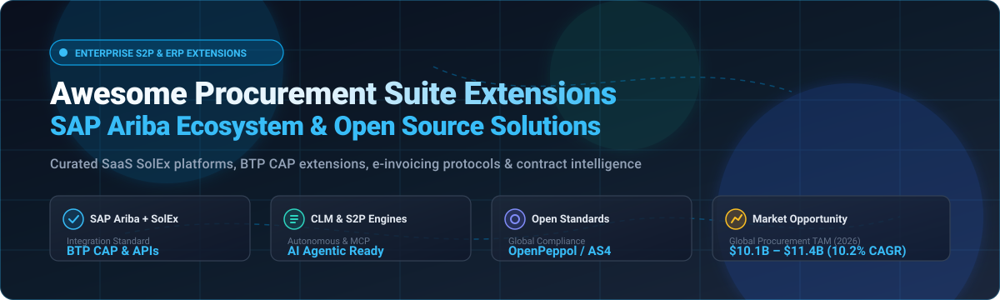

# Awesome Procurement Suite Extensions (SAP Ariba) ⚡🛒

  

  
  
  
  
  
  

> 🌟 **A curated, battle-tested directory of top Procurement Suite Extensions, SAP Ariba SolEx platforms, spend management integrations, BTP CAP services, and open-source e-procurement alternatives for extending modern Source-to-Pay (S2P) workflows.** 🚀

---

## 📑 Table of Contents
- [🔍 Sector Overview & Market Dynamics](#-sector-overview--market-dynamics)
- [🏢 SaaS & Commercial Enterprise Platforms](#-saas--commercial-enterprise-platforms)
  - [Feature Deep-Dive](#-feature-deep-dive)
- [💻 Open-Source Software & Extensions](#-open-source-software--extensions)
- [📊 Comparison at a Glance](#-comparison-at-a-glance)
- [🤝 Contributing](#-contributing)
- [📈 Star History](#-star-history)
- [💖 Support](#-support)
- [📄 License](#-license)

---

## 🔍 Sector Overview & Market Dynamics

The global procurement and business spend management software market is estimated at **$10.1B to $11.4B by 2026** (scaling from ~$8.5B–$9.3B in 2024–2025 at an annual CAGR of **~10.2%**). The sector exhibits **moderate market concentration**: a core vanguard of top-tier enterprise players (SAP Ariba, Coupa, Oracle, Ivalua, JAGGAER, and Zycus) captures approximately **59%** of total market revenue, while the remaining **41%** remains fragmented among agile, specialized SaaS extensions focusing on AI-native intake, contract lifecycle intelligence (CLM), tail spend automation, global tax/AP compliance, and decentralized B2B integrations.

---

## 🏢 SaaS & Commercial Enterprise Platforms

Commercial, cloud-hosted Procurement Suite Extensions and integrations for SAP Ariba and enterprise Source-to-Pay ecosystems. The table below compares verified enterprise pricing tiers, free tier / trial terms, and business scale metrics (sorted in descending order by company valuation / annual revenue).

| Platform 🏷️ | Primary Category ⚙️ | Valuation / Annual Revenue 💰 | Verified Pricing Tier 💳 | Free Tier / Trial Limits ⏱️ | Best For 🎯 |
|---|---|---|---|---|---|
| **[Coupa App Marketplace](https://marketplace.coupa.com/)** | Spend Management & Partner Ecosystem | **$8.0B Valuation** (~$800M–$1.0B ARR) | Starting at ~$15,000 – $50,000/yr (entry modules); mid-market $50k–$250k+/yr | ❌ No free trial for core buyer platform; Free basic tier available on Coupa Supplier Portal (CSP) for suppliers | Pre-built integrations extending procurement into finance, tail spend, & negotiation |
| **[Icertis Contract Intelligence](https://www.icertis.com/)** | SAP Solution Extension (SolEx) CLM | **$5.0B Valuation** (~$350M ARR) | Starting median ACV at ~$88,000/yr (year-1 implementations $100k–$300k+) | ❌ No free tier or self-serve free trial; guided sandbox POC provided upon sales engagement | Enterprise SAP-certified CLM with embedded SAP S/4HANA UX & agentic contract intelligence |
| **[Tipalti Connect](https://tipalti.com/)** | Global Payables & Supplier Onboarding | **$2.0B+ Valuation** (~$100M+ ARR) | Starting at **$99/month** (AP Automation / Select tier); Mass Payouts from **$249/month** | ❌ No free plan or self-serve free trial; custom 1-on-1 guided product demo available | Global payables automation, cross-border remittances, supplier tax & VAT compliance |
| **[Ivalua Integration Hub](https://www.ivalua.com/)** | Multi-ERP S2P & MCP AI Agent Hub | **~$150M – $250M ARR** (Private Equity backed) | Starting modular deployments at ~$150,000 – $180,000/yr; full suites $400k+/yr | ❌ No free plan or self-serve free trial; enterprise RFP demonstration on demand | Enterprises with complex multi-ERP landscapes requiring bidirectional Model Context Protocol (MCP) support |
| **[JAGGAER Connect](https://www.jaggaer.com/)** | ERP Integration & Source-to-Pay Suite | **~$150M – $200M+ ARR** (Cinven owned) | Modular framework plans starting from ~£4,600 – £10,000/yr ($6k–$13k); standalone enterprise suites ~$165,000/yr | ❌ No free trial or free version; custom guided sandbox demos available upon RFP request | Organizations requiring pre-built connectors (SAP, Oracle, NetSuite) across higher-ed & public sector |
| **[Basware P2P](https://www.basware.com/)** | Global E-Invoicing Network & Accounts Payable | **~$150M – $180M ARR** (Arrowroot Capital) | Custom volume-based tiers starting around ~$12,000 – $25,000/yr based on invoice throughput & format count | ❌ No free trial or free tier; customized live architectural demo and format assessment on request | E-invoicing and purchase-to-pay automation across 70+ global compliance and e-delivery formats |
| **[Zycus Merlin Agentic Platform](https://www.zycus.com/)** | Autonomous S2P Suite & AI Procurement | **~$100M+ ARR** (Privately held) | Entry modular spend analytics (*iAnalyze*) starting at ~$140,000 – $260,000/yr | ❌ No free tier or open trial; structured enterprise pilot proof-of-concept (PoC) upon qualification | End-to-end Source-to-Pay automation driven by autonomous agentic workflows & MS Teams guided intake |

---

### 🔍 Feature Deep-Dive

#### 🔹 [Coupa App Marketplace](https://marketplace.coupa.com/)
* **Type:** Partner ecosystem for procurement and spend management 🌐
* **Capabilities:** Certified integrations that extend Coupa's spend management capabilities. Listings include **Spendflo** for AI SaaS negotiation, **Torii** for SaaS contract visibility, **Pactum AI** for autonomous purchase request negotiations, **Fairmarkit** for tail spend sourcing automation, and **CrossConnect** connectors for Sage Intacct, QuickBooks Online, and Workday. Includes **MuleSoft Connector by AcquisLink** for streamlined enterprise integration development.
* **Target Audience:** Enterprises wanting pre-built, certified integrations extending procurement into finance, SaaS management, and autonomous negotiation without custom development.

#### 🔹 [Icertis Contract Intelligence for SAP Ariba](https://www.icertis.com/sap/)
* **Type:** SAP Solution Extension (SolEx) for Contract Lifecycle Management 📜
* **Capabilities:** SAP's **only Solution Extension (SolEx) partner for CLM**, providing a strategically aligned, SAP premium-certified platform rather than just an integration. Available in **Premium and Premium Plus editions** for contract visibility, automation, and AI-powered insights. Contract intelligence is natively embedded in the SAP UX, enabling authoring, redlining, insights, and obligation tracking across the contract lifecycle with agentic contracting in S/4HANA workflows.
* **Target Audience:** SAP-centric enterprises wanting a certified, SAP-embedded CLM extension with AI-native contracting capabilities.

#### 🔹 [Tipalti Connect](https://tipalti.com/)
* **Type:** Global payables automation & supplier onboarding 💳
* **Capabilities:** Streamlines supplier onboarding, invoice processing, mass payments, tax compliance (W-9 / W-8), and financial reconciliation. Extends ERP workflows with bi-directional syncing across payables, procurement, expenses, and corporate cards. Provides OAuth 2.0 with PKCE and client credential APIs across production and sandbox environments.
* **Target Audience:** Fast-growing digital businesses and finance teams looking to automate global disbursements and payables compliance.

#### 🔹 [Ivalua Integration Hub](https://www.ivalua.com/)
* **Type:** Unified integration platform with multi-ERP & AI agent support 🤖
* **Capabilities:** Pre-built connectors and templates for SAP S/4HANA, ECC, Oracle, Microsoft Dynamics, Workday, Dun & Bradstreet supplier intelligence, and DocuSign e-signatures. A major differentiator is **bidirectional Model Context Protocol (MCP) support**: Ivalua's IVA agent can call external MCP servers, and external AI agents can govern Ivalua workflows through a hosted MCP server. Multi-ERP integration operates on a single instance without secondary integration licensing.
* **Target Audience:** Enterprises with complex multi-ERP landscapes seeking unified Source-to-Pay governance and native agentic AI connectivity.

#### 🔹 [JAGGAER Connect](https://www.jaggaer.com/)
* **Type:** ERP integration & source-to-pay connectivity 🔗
* **Capabilities:** Standardized integration between JAGGAER Source-to-Pay solutions and core ERP, HCM, and finance platforms. Provides pre-built ERP connectors for SAP, Oracle, NetSuite, and Ellucian via JAGGAER Link. Backed by open REST APIs and high-availability Infrastructure-as-a-Service (IaaS).
* **Target Audience:** Higher-education, manufacturing, healthcare, and public sector organizations requiring resilient ERP integrations with minimal IT maintenance overhead.

#### 🔹 [Basware P2P](https://www.basware.com/)
* **Type:** Global e-invoicing and purchase-to-pay network 🌐
* **Capabilities:** Cloud-based e-invoicing and accounts payable automation with REST APIs for submitting and receiving electronic invoices across **70+ formats**, managing POs, processing AP, and archiving audit-compliant documents. The Basware Network connects buyers and suppliers worldwide through a single automated format conversion gateway.
* **Target Audience:** Global enterprises requiring e-invoicing regulatory compliance and automated cross-border AP matching.

#### 🔹 [Zycus Merlin Agentic Platform](https://www.zycus.com/)
* **Type:** Source-to-pay suite powered by Agentic AI ⚡
* **Capabilities:** Full Source-to-Pay suite with autonomous AI agents across intake, procure-to-pay, source-to-contract, and orchestration. **Merlin Intake** embeds within Microsoft Teams for conversational procurement requests, speeding intake cycle times by up to 70%. **Zycus AppXtend** enables custom apps on top of a unified PaaS architecture.
* **Target Audience:** Procurement leadership seeking an organically integrated S2P suite featuring built-in autonomous agentic execution.

---

## 💻 Open-Source Software & Extensions

Community-driven, open-source Procurement Suite Extensions, BTP CAP reference architectures, and e-delivery protocols. Sorted by GitHub_Stars_Count in descending order.

| Open-Source Project 📦 | GitHub_Stars ⭐ | Primary Stack 🛠️ | License 📜 | Ariba Relevance & Architecture 🔌 | Description & Focus 💡 |
|---|---|---|---|---|---|
| **[ERPNext](https://github.com/frappe/erpnext)** |  | Python / JavaScript / MariaDB | GPL-3.0 | 🔄 Alternative ERP / S2P Engine | Full-featured, self-hosted open-source ERP with comprehensive procurement, purchase orders, RFQ, supplier portals, and two-way matching. |
| **[OpenProcurement API](https://github.com/openprocurement/openprocurement.api)** |  | Python / CouchDB | Apache-2.0 | 🏛️ Public Procurement & Tendering | Open-source procurement datastore and API underpinning high-volume, transparent electronic tenderings, auctions, and contract awards. |
| **[Oxalis-NG](https://github.com/OxalisCommunity/oxalis-ng)** |  | Java | Apache-2.0 / LGPL-3.0 | 🇪🇺 Peppol eDelivery AS4 Gateway | Next-generation implementation of the OpenPeppol AS4 profile for exchanging e-invoices and procurement business documents across European and global networks. |
| **[Ariba Extensibility Samples](https://github.com/SAP-archive/ariba-extensibility-samples)** |  | Jupyter / Python / Node.js | Apache-2.0 | 📑 SAP Ariba Developer Reference | Curated code samples for communicating with SAP Ariba Developer Portal APIs, SAP Cloud Connector, and SAP HANA Cloud integration. |
| **[BTP Procurement Data Extractor](https://github.com/SAP-archive/btp-procurement-data-extractor)** |  | SAP BTP CAP / Node.js | Apache-2.0 | 📊 Ariba Cloud Services Extractor | Reference BTP application retrieving SAP Ariba Cloud Services spend and transactional data through standard APIs into SAP BTP databases. |
| **[ITK Lite 4 Procurement](https://github.com/SAP-samples/btp-integration-toolkit-lite)** |  | SAP BTP CAP / Node.js / PostgreSQL | Apache-2.0 | 🔄 Ariba ITK Official Replacement | BTP CAP application replacing the deprecated SAP Ariba Integration Toolkit (ITK), connecting SAP Ariba with non-SAP ERPs via SFTP and automated CSV batch exchange. |
| **[Lite Inventory Management](https://github.com/SAP-samples/liteinventorymanagement)** |  | SAP BTP CAP / Node.js / SAP HANA | Apache-2.0 | 📦 Ariba Catalog Management Sync | Lightweight BTP inventory application managing Goods Receipts, Goods Issues, and automatic inventory synchronization with SAP Ariba Catalog Management. |
| **[Tail Spend Management](https://github.com/SAP-samples/tailspendmanagement)** |  | SAP BTP CAP / JavaScript | Apache-2.0 | 🎯 Ariba Tail Spend Automation | BTP CAP application addressing unmanaged tail spend through automated RFP event rules, region/commodity supplier mapping, and quotation automation. |
| **[SLP Supplier Validation Controls](https://github.com/SAP-samples/slp-supplier-validation)** |  | SAP BTP CAP / JavaScript | Apache-2.0 | 🛡️ Ariba SLP Onboarding Extender | Centrally validates supplier tax IDs, bank details, and business licenses during SAP Ariba Supplier Lifecycle and Performance (SLP) registration. |

---

## 📊 Comparison at a Glance

| Solution / Framework 🛡️ | Type & Architecture 📐 | Native Ariba Alignment 🧩 | Multi-ERP Ready 🏢 | Self-Hostable 💻 | Primary Use Case 🚀 |
|---|---|---|---|---|---|
| **Icertis Contract Intelligence** | Enterprise SolEx SaaS | ✅ Premium SolEx (Embedded UX) | ✅ Yes | ❌ | AI Contract Lifecycle Management & Risk |
| **Coupa App Marketplace** | Spend Management Platform | ❌ Coupa Native Ecosystem | ✅ Yes | ❌ | Autonomous spend & partner integrations |
| **Tipalti Connect** | FinTech Payables Cloud | 🔗 ERP Connector & APIs | ✅ Yes | ❌ | Global accounts payable & mass remittances |
| **Ivalua Integration Hub** | Enterprise S2P Suite | 🔗 Multi-ERP + MCP Server | ✅ Yes | ❌ | Bidirectional AI agent integration & S2P |
| **JAGGAER Connect** | Enterprise S2P Platform | 🔗 Pre-built ERP Connectors | ✅ Yes | ❌ | Public sector, education & direct procurement |
| **Basware P2P** | E-Invoicing Global Network | 🔗 REST APIs + Peppol | ✅ Yes | ❌ | Multi-format e-invoicing compliance (70+ formats) |
| **Zycus Merlin Agentic Platform** | Agentic AI S2P Suite | 🔗 S2P Cloud Connectors | ✅ Yes | ❌ | Conversational Teams intake & agentic S2P |
| **ERPNext** | Full Open-Source ERP | ❌ Standalone Open ERP | ✅ Yes | ✅ | Complete self-hosted procurement & supply chain |
| **OpenProcurement API** | Open Public Tendering Engine | ❌ Open Standards API | ✅ Via API | ✅ | Transparent government and institutional bidding |
| **Oxalis-NG** | AS4 e-Delivery Protocol | 🔗 Peppol Access Point | ✅ Yes | ✅ | OpenPeppol AS4 European e-invoicing gateway |
| **ITK Lite 4 Procurement** | SAP BTP CAP Reference App | ✅ Dedicated ITK Replacement | ✅ SFTP / Non-SAP | ✅ (BTP Cloud) | SFTP batch master/spend file synchronization |
| **BTP Procurement Data Extractor** | SAP BTP Cloud Foundry App | ✅ Direct Ariba APIs | ⚠️ Ariba Focused | ✅ (BTP Cloud) | Enterprise spend analytics extraction |
| **Lite Inventory Management** | SAP BTP CAP Application | ✅ Ariba Catalog Integration | ⚠️ Ariba Focused | ✅ (BTP Cloud) | Mid-market stock tracking & Ariba catalog sync |
| **Tail Spend Management** | SAP BTP CAP Application | ✅ Ariba Sourcing Augmentation | ⚠️ Ariba Focused | ✅ (BTP Cloud) | Auto RFP dispatch & preferred vendor rules |
| **SLP Supplier Validation** | SAP BTP CAP Application | ✅ Ariba SLP Lifecycle | ⚠️ Ariba Focused | ✅ (BTP Cloud) | External third-party supplier validation checks |

---

## 🤝 Contributing

Contributions are welcomed! Help expand this directory by submitting pull requests for verified extensions, BTP sample implementations, or enterprise Source-to-Pay connectors:

1. 🍴 **Fork** the repository
2. 🌿 **Create a new branch**: `git checkout -b feature/new-extension`
3. 📝 **Add your project** in alphabetical order with verified pricing, stack, and architectural links
4. 🚀 **Submit a Pull Request** with a concise summary of your addition

Please check our [Contributing Guidelines](https://github.com/ishandutta2007/Awesome-Awesome-Awesome) for quality benchmarks.

---

## 📈 Star History

---

## 💖 Support

Thank you for visiting and supporting the **Awesome Procurement Suite Extensions** project! 🌟

If you found this directory helpful for your enterprise architecture evaluations, please consider:
- ⭐ **Starring this repository** on GitHub to improve visibility!
- 🍴 **Forking and sharing** it with your enterprise integration, SAP, and procurement engineering teams!
- ☕ **Sponsoring the project** or buying us a coffee via the [GitHub Sponsor Dashboard](https://github.com/sponsors/ishandutta2007)!

Every star and contribution directly fuels the ongoing maintenance and expansion of open-source knowledge bases. 🙌

---

## 📄 License

This repository and curated collection are released under the [CC0 1.0 Universal (Public Domain)](https://creativecommons.org/publicdomain/zero/1.0/) license. All third-party product names, logos, and trademarks are property of their respective owners.
